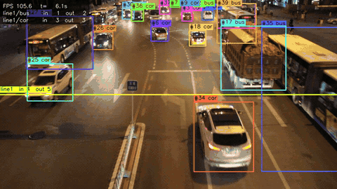

# traffic-cv

Детекция, трекинг и подсчёт транспорта на видео с дорожных камер: YOLO11s, дообученный на UA-DETRAC, собственные ByteTrack и SORT, счётчик пересечений линии по классам и направлениям, экспорт в ONNX / TensorRT FP16 / INT8 и перенос инференса на Rust.



Полное демо (три ролика из test: день, ночь, перекрёсток с зоной остановки) лежит в DVC: `dvc pull assets/demo.mp4`.

## Результаты

| Что | Метрика | Значение |
| --- | --- | --- |
| Детекция, test | mAP@0.5 baseline → finetune | 0.667 → **0.682** |
| Трекинг, test | MOTA / IDF1, ByteTrack vs SORT | **0.733 / 0.799** vs 0.719 / 0.717 |
| Подсчёт, 40 test-видео | ошибка суммарного счёта, ByteTrack | **2.2%** |
| Подсчёт, демо-ролик MVI_39031 | авто vs эталон | 39 vs 40, **2.5%** |
| Скорость, T4 | TensorRT INT8 / FP16 / PyTorch, кадров/с | **209** / 195 / 95 при ΔmAP −2.0% / −0.4% |
| Скорость, Apple M5 CPU | Rust vs Python, весь пайплайн | **82** vs 22 кадров/с |

Все цифры пересчитываются командами из раздела «Как запустить», отчёты лежат в `reports/`.

## Задача

По видео с дорожной камеры найти транспорт, дать каждому объекту постоянный ID, посчитать пересечения линии по классам и направлениям и уложиться в реальное время после оптимизации под edge.

## Данные

[UA-DETRAC](https://detrac-db.rit.albany.edu/): 100 видео с камер над дорогами Пекина и Тяньцзиня, 960×540, 25 кадров/с, 140 тыс. кадров, рамки и треки для каждого кадра. В разметке четыре класса: `car`, `bus`, `van`, `others`. Пешеходов и отдельного класса `truck` в датасете нет (грузовики попадают в `others`), поэтому модель обучена на этих четырёх классах.

- **Разбиение по видео, не по кадрам.** Официальные 40 test-видео оставлены как test, из 60 train-видео 9 ушли в val со стратификацией по погоде. Кадры одного ролика никогда не попадают в разные выборки.
- **Прореживание.** Соседние кадры почти одинаковые, поэтому в YOLO-датасет взят каждый 5-й кадр train и каждый 10-й val/test. Для трекинга и подсчёта используются все кадры test-видео.
- **Игнорируемые области.** В DETRAC есть зоны без разметки (дальние парковки, пробки). Они закрашены серым на кадрах для обучения, а в оценке трекинга и подсчёта объекты в них не учитываются ни в разметке, ни в предсказаниях.
- **DVC.** Сконвертированный датасет, веса и демо-видео лежат в DVC-хранилище на DagsHub (S3-совместимое).

| split | видео | кадров | кадров в YOLO | треков | рамок |
| --- | --- | --- | --- | --- | --- |
| train | 51 | 70 751 | 14 153 | 4 841 | 104 998 |
| val | 9 | 13 040 | 1 305 | 1 111 | 6 984 |
| test | 40 | 56 340 | 5 640 | 2 337 | 63 757 |

| класс | рамок | доля |
| --- | --- | --- |
| car | 146 495 | 83.4% |
| van | 14 082 | 8.0% |
| bus | 12 841 | 7.3% |
| others | 2 321 | 1.3% |

Условия съёмки (видео train / val / test): облачно 16/3/11, ночь 14/2/12, дождь 8/2/9, солнце 13/2/8. Подробнее: [`reports/eda/stats.md`](reports/eda/stats.md), графики: [`reports/eda/eda.png`](reports/eda/eda.png).

## Архитектура

```
видео ─► Detector (YOLO11s: .pt / .onnx / .engine) ─► dets (x1,y1,x2,y2,score,cls)
      ─► Tracker (ByteTrack | SORT, свой код: Kalman + венгерский алгоритм)
      ─► tracks (x1,y1,x2,y2,id,score,cls)
      ─► LineCounter (по классам и направлениям) + DwellZone (остановка дольше N секунд)
      ─► events.csv / .jsonl, tracks.txt, summary.json, видео с разметкой
```

| Модуль | Где |
| --- | --- |
| конвертация DETRAC → YOLO и MOT, разбиение, EDA | `src/traffic_cv/data/` |
| обучение, аугментации, оценка детекции | `src/traffic_cv/detection/` |
| Kalman, ByteTrack, SORT, оценка MOTA/IDF1 | `src/traffic_cv/tracking/` |
| счётчик линии, зона, запись событий, оценка подсчёта | `src/traffic_cv/events/` |
| экспорт ONNX / INT8 / TensorRT, бенчмарк, сверка с Rust | `src/traffic_cv/export/` |
| CLI | `run.py` |
| Rust: ядро (трекеры, счётчик), бинарник (ort + opencv), модуль PyO3 | `rust-infer/{core,infer,py}` |
| пайплайн DVC | `dvc.yaml`, параметры в `configs/` |

## Решения и почему

- **YOLO11s.** Small-модель держит реальное время на edge-GPU и даже на CPU, а у Ultralytics готовый экспорт в ONNX и TensorRT с INT8-калибровкой.
- **Аугментации подобраны под скорость, а не только под качество.** Первая версия (дождь, туман, defocus, JPEG-артефакты) считалась на CPU и замедлила эпоху в 5 раз: 16 минут против 3 на T4. Оставлены яркость/контраст, гамма, размытие, шум, ToGray и горизонтальный флип. Эпоха вернулась к 3 минутам, а mAP@0.5 на test вырос на 1.5 п.п.
- **Свои трекеры вместо готовых.** Их нужно было переносить на Rust и сверять бит в бит, поэтому ByteTrack и SORT написаны с нуля на numpy с общим фильтром Калмана. Rust-версия даёт те же MOTA и IDF1 до последнего знака.
- **ByteTrack — основной трекер.** Второй проход по детекциям с низким score и буфер потерянных треков дают на 8 п.п. выше IDF1 и в 3.5 раза меньше смен ID, чем у SORT.
- **Эталон для подсчёта — разметка DETRAC.** Треки в ней размечены людьми покадрово, поэтому прогон их через ту же линию и есть «ручной подсчёт», только на 40 видео, а не на одном.
- **Линия на каждое видео выбирается правилом:** поперёк основного потока, в нижней половине кадра, где машины крупные. Правило выбрано на val, координаты лежат в `configs/counting.yaml` и правятся руками.
- **Гистерезис у линии есть, но выключен.** На val он давал выигрыш в пределах шума, а на test треки рвутся чаще, и зазор приводит к недосчёту.
- **Обучение на Kaggle T4, всё остальное локально.** Метрики по эпохам уходят в MLflow на DagsHub, веса — в DVC сразу после обучения, чтобы не потерять их при обрыве сессии.

## Метрики

### Детекция (test, 40 видео)

| модель | mAP@0.5 | mAP@0.5:0.95 | P | R | AP50 car | AP50 bus | AP50 van | AP50 others |
| --- | --- | --- | --- | --- | --- | --- | --- | --- |
| baseline (COCO → DETRAC, без аугментаций) | 0.667 | 0.481 | 0.696 | 0.652 | 0.879 | 0.827 | **0.604** | 0.359 |
| finetune (albumentations) | **0.682** | **0.492** | **0.718** | **0.664** | **0.905** | **0.841** | 0.582 | **0.400** |

Обе модели — YOLO11s с весами COCO, 640 px, ранняя остановка по val (baseline остановился на 38-й эпохе из 50, finetune обучался 35 эпох). Эксперименты в MLflow на DagsHub.

### Трекинг (test, 56 340 кадров, детекции от finetune)

| трекер | MOTA | IDF1 | смены ID | FP | FN | мс/кадр |
| --- | --- | --- | --- | --- | --- | --- |
| **ByteTrack** | **0.733** | **0.799** | **1 095** | 49 099 | 118 552 | 0.23 |
| SORT | 0.719 | 0.717 | 3 826 | 58 567 | 114 863 | 0.22 |

### Подсчёт (test, 40 видео, линия на каждое видео)

| трекер | эталон | авто | суммарная ошибка | ошибка по видео и направлениям | медиана по видео | видео с ошибкой ≤5% |
| --- | --- | --- | --- | --- | --- | --- |
| **ByteTrack** | 1 650 | 1 613 | **2.2%** | **12.3%** | **8.7%** | **40%** |
| SORT | 1 650 | 1 590 | 3.6% | 15.2% | 11.6% | 32.5% |

Разбивка по видео: [`reports/counting/compare.md`](reports/counting/compare.md). События пишутся в CSV/JSONL с полями `frame, time_s, track_id, class_id, class_name, event, detail, source`.

### Оптимизация (finetune, 640×640, batch 1)

| устройство | формат | размер, МБ | модель, мс | кадр целиком, мс | кадров/с | mAP@0.5 | mAP@0.5:0.95 | ΔmAP@0.5 | совпадение с .pt |
| --- | --- | --- | --- | --- | --- | --- | --- | --- | --- |
| T4 | PyTorch FP32 | 18.3 | 8.1 | 10.5 | 95 | 0.682 | 0.492 | — | эталон |
| T4 | **TensorRT FP16** | 94.8 | 2.5 | 5.1 | 195 | 0.679 | 0.483 | −0.4% | 98.8% |
| T4 | **TensorRT INT8** | 48.0 | **2.2** | **4.8** | **209** | 0.668 | 0.470 | −2.0% | 95.8% |
| Kaggle CPU (Xeon 2.0 ГГц) | ONNX FP32 | 36.2 | 224.6 | 228.4 | 4 | 0.680 | 0.484 | −0.4% | 98.9% |
| Kaggle CPU (Xeon 2.0 ГГц) | ONNX INT8 | **12.0** | 117.6 | 121.8 | 8 | 0.684 | 0.478 | +0.3% | 94.2% |
| Apple M5, GPU | PyTorch (MPS) | 18.3 | 2.3 | 8.3 | 121 | 0.682 | 0.492 | — | эталон |
| Apple M5, CPU | PyTorch FP32 | 18.3 | 28.2 | 28.9 | 34 | 0.682 | 0.492 | — | эталон |
| Apple M5, CPU | ONNX FP32 | 36.2 | 31.8 | 32.9 | 30 | 0.680 | 0.484 | −0.4% | 98.9% |
| Apple M5, CPU | ONNX INT8 | 12.0 | 25.1 | 26.2 | 38 | 0.680 | 0.484 | −0.2% | 96.6% |

- **ONNX совпадает с PyTorch:** 98.9% рамок, mAP −0.4%. Остаток разницы — из-за того, что PyTorch на валидации использует прямоугольный letterbox (640×384), а статический ONNX — квадратный 640×640.
- **TensorRT INT8** (калибровка на 326 кадрах val через ModelOpt) теряет 2.0% mAP@0.5 и укладывается в бюджет 2–3%. Модель ускоряется в 3.7 раза, весь кадр с пре- и постобработкой — в 2.2 раза.
- **ONNX INT8 на слабом CPU** (QDQ, статическая калибровка на 300 кадрах, голова Detect оставлена в FP32) даёт ускорение в 1.9 раза без потери mAP, а файл становится в 3 раза меньше.
- Размер `.engine` больше `.onnx`: в файл входят скомпилированные под T4 ядра. Движок привязан к GPU и версии TensorRT, на другом устройстве его нужно собрать заново.
- ONNX Runtime с CUDA на Kaggle не запустился: pip-сборка `onnxruntime-gpu` несовместима с cuDNN 9.27 из образа. Для GPU используется TensorRT.

ΔmAP считается относительно PyTorch FP32 на той же машине. «Совпадение с .pt» — доля рамок PyTorch (score ≥ 0.25), для которых у оптимизированной модели есть рамка того же класса с IoU ≥ 0.5. Полные отчёты: [`reports/export/`](reports/export/).

### Rust vs Python (MVI_39031, 1 470 кадров, Apple M5, CPU, одна и та же ONNX-модель)

| пайплайн | кадров/с | кадр p50, мс | кадр p95, мс | детектор p50, мс | трекер p50, мс | пиковая память, МБ | счёт in/out |
| --- | --- | --- | --- | --- | --- | --- | --- |
| Python (Ultralytics + onnxruntime) | 21.8 | 43.5 | 46.5 | 38.3 | 0.34 | 687 | 23/16 |
| **Rust** (ort + opencv) | **81.7** | **11.0** | **11.7** | **8.4** | **0.01** | **325** | 23/16 |

- Совпадение: 99.6% рамок Python найдены в Rust (IoU ≥ 0.5, тот же класс), средний IoU 0.98, счёт на линии одинаковый.
- Размеры: бинарник 18.9 МБ (ONNX Runtime слинкован статически). Docker-образ Rust — 248 МБ, Python с CUDA — 9.7 ГБ.
- Основной выигрыш даёт не язык, а сборка ONNX Runtime: та же модель через `ort` считается за 8 мс даже в одном потоке, а через pip-пакет `onnxruntime` — за 30–39 мс. Обвязка вокруг модели (пре- и постобработка, трекер, отрисовка) в Python занимает около 13 мс на кадр, в Rust — около 3 мс.
- Трекеры из Rust подключены к Python через PyO3 (`bytetrack-rs`, `sort-rs`). На всём test они дают те же MOTA и IDF1, что и Python-версии, и работают в 20 раз быстрее: [`reports/rust/trackers.md`](reports/rust/trackers.md).

## Ограничения

- **Классы.** В UA-DETRAC нет пешеходов и отдельного класса грузовиков, поэтому модель их не различает. `others` и `van` — слабые места: AP50 0.40 и 0.58, ошибка подсчёта по этим классам 83% и 54%, в основном из-за путаницы van/car.
- **Ночь.** На ночных роликах детектор пропускает заметно больше машин; худший пример — MVI_40761, где автоматический счёт на треть ниже эталона (43 против 65).
- **Суммарная ошибка подсчёта 2.2% частично держится на компенсации** недосчёта и пересчёта между видео. По отдельному видео медианная ошибка 8.7%.
- **Одна линия на ролик.** На перекрёстках с несколькими потоками нужно несколько линий (CLI это поддерживает, оценка — нет).
- **Без компенсации движения камеры.** Камеры в DETRAC статичны; на дрожащей камере Kalman без CMC будет терять треки.
- **Скорость CPU зависит от сборки ONNX Runtime** (см. Rust vs Python). Цифры GPU сняты на Kaggle T4; на Jetson TensorRT-движок нужно собирать заново на самом устройстве.

## Как запустить

Нужны Python 3.11+ и [uv](https://docs.astral.sh/uv/). Для Rust — `rustup`, OpenCV 4.x/5.x и libclang: на macOS `brew install opencv llvm pkg-config`, на Debian/Ubuntu `apt install libopencv-dev clang libclang-dev`.

### 1. Установка

```bash
git clone https://github.com/jestersw/trafic-cv.git && cd trafic-cv
uv sync --all-extras
uv run pytest -q
```

### 2. Данные и модели

Через DVC (нужен бесплатный аккаунт DagsHub и токен из Settings → Tokens):

```bash
uv run dvc remote modify dagshub --local access_key_id <dagshub-token>
uv run dvc remote modify dagshub --local secret_access_key <dagshub-token>
uv run dvc pull data/processed/detrac models/baseline.pt models/finetune.pt models/finetune.onnx models/finetune_int8.onnx assets/demo.mp4
```

Или с нуля из оригинального датасета. Архивы `DETRAC-Images.zip`, `DETRAC-Train-Annotations-XML.zip` и `DETRAC-Test-Annotations-XML.zip` скачиваются скриптом (Google Drive может отдать «too many users», тогда он напечатает ссылки для браузера):

```bash
uv run python -m traffic_cv.data.download
uv run dvc repro convert eda
```

Сырые кадры (`data/raw/UA-DETRAC`, 9.4 ГБ) нужны только для трекинга и подсчёта: там используются все кадры test-видео.

### 3. Обучение (GPU)

`notebooks/train_gpu.ipynb` — Kaggle или Colab. В секретах `DAGSHUB_USER` и `DAGSHUB_TOKEN`, затем Save & Run All. Ноутбук скачивает данные через DVC, обучает модели (`dvc repro -s train_baseline` / `train_finetune`), пишет метрики в MLflow на DagsHub и отправляет веса в DVC. Параметры обучения — `configs/train.yaml`.

### 4. Оценка

```bash
uv run dvc repro -s compare_detection eval_tracking eval_counting
```

Или по отдельности:

```bash
uv run python -m traffic_cv.detection.evaluate --weights models/baseline.pt models/finetune.pt
uv run python -m traffic_cv.tracking.evaluate --weights models/finetune.pt --trackers bytetrack sort
uv run python -m traffic_cv.events.evaluate --weights models/finetune.pt
```

### 5. Запуск на видео

```bash
uv run python run.py --video input.mp4 --model models/finetune.pt --line 0,324,960,324 --device 0
uv run python run.py --video input.mp4 --model models/finetune_fp16.engine --line 0,324,960,324 \
    --zone "480,380;960,380;960,540;480,540" --dwell 5 --tracker bytetrack
```

`--device`: `0` — NVIDIA GPU, `mps` — Apple GPU, `cpu`; без него Ultralytics выбирает CUDA, если она есть, иначе CPU. Для проверки без своих видео подойдёт демо-ролик `assets/demo.mp4`. Вместо файла можно передать последовательность кадров: `--video "data/raw/UA-DETRAC/DETRAC-Images/MVI_39031/img%05d.jpg"`. Результат в `outputs/<имя>/`: `video.mp4`, `events.csv`, `tracks.txt` (формат MOT) и `summary.json` со счётчиками и задержками. Линия задаётся как `x1,y1,x2,y2` в пикселях кадра. Направление `in` — переход на ту сторону, куда указывает нормаль слева направо вдоль линии (для горизонтальной линии слева направо — сверху вниз).

### 6. Экспорт и бенчмарк

```bash
uv run python -m traffic_cv.export.export --formats onnx onnx-int8
uv run python -m traffic_cv.export.benchmark --models models/finetune.pt@mps models/finetune.onnx@cpu models/finetune_int8.onnx@cpu
```

TensorRT (`--formats engine-fp16 engine-int8`) собирается только на NVIDIA GPU. Готовый Kaggle-скрипт с экспортом и бенчмарком на T4: `notebooks/kaggle_export/` (`kaggle kernels push -p notebooks/kaggle_export`; данные для него — приватный Kaggle-датасет с весами и val/test кадрами).

### 7. Docker

```bash
docker build -f docker/Dockerfile -t traffic-cv .
docker run --gpus all --rm -v $PWD/models:/app/models -v $PWD/outputs:/app/outputs -v /path/to/videos:/videos \
    traffic-cv --video /videos/input.mp4 --model models/finetune.pt --line 0,324,960,324 --device 0
```

Образ основан на `nvidia/cuda` с cuDNN; на x86_64 в него дополнительно ставятся `onnxruntime-gpu` и TensorRT, так что работают `.pt`, `.onnx` и `.engine`.

### 8. Rust

```bash
cd rust-infer
export DYLD_FALLBACK_LIBRARY_PATH="$(brew --prefix llvm)/lib"
cargo test -p traffic-core
cargo run --release -- --video input.mp4 --model ../models/finetune.onnx --line 0,324,960,324 --out-dir ../outputs/rust
```

Строка с `DYLD_FALLBACK_LIBRARY_PATH` нужна только на macOS: без неё крейт `opencv` не находит `libclang` при сборке. Флаги `--ep cuda|tensorrt|coreml` включаются фичами при сборке (`cargo build --release --features tensorrt`). `--dump-dets` пишет детекции по кадрам для сверки с Python:

```bash
uv run python -m traffic_cv.export.compare_rust
```

Rust-образ: `docker build -f docker/Dockerfile.rust -t traffic-cv-rust .` (248 МБ).

Модуль трекеров для Python:

```bash
uvx maturin build --release -m rust-infer/py/Cargo.toml -i .venv/bin/python
uv pip install rust-infer/target/wheels/*.whl
uv run python run.py --video input.mp4 --model models/finetune.pt --line 0,324,960,324 --tracker bytetrack-rs
```

## Структура

```
configs/          параметры данных, обучения и линий подсчёта
data/             raw (DETRAC) и processed (YOLO + MOT), под DVC
src/traffic_cv/   data, detection, tracking, events, export, pipeline, viz
run.py            CLI
notebooks/        обучение на Kaggle/Colab, экспорт TensorRT на Kaggle
reports/          EDA, детекция, трекинг, подсчёт, экспорт, Rust
rust-infer/       core (трекеры, счётчик), infer (бинарник), py (PyO3)
docker/           Dockerfile (Python + CUDA) и Dockerfile.rust
tests/            pytest
```
